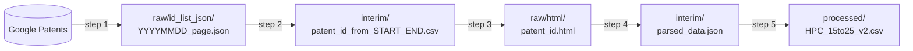

# Google Patents HPC Dataset Pipeline

Python scripts that build a patent dataset from [Google Patents](https://patents.google.com/) in five steps:
search Google Patents one filing date at a time, collect the patent IDs, download each patent page,
parse the pages, and flatten the result into one CSV file. A sixth step, a Colab notebook in `colab/`, turns
that CSV file into the released dataset (see [Step 6](#step-6-build-the-released-dataset-on-colab-notebooks-in-colab)).

The default settings reproduce the **HPC dataset**: US granted patents in English that match the query
`(HPC)` and were **filed** between 2015-01-01 and 2025-12-31. Every setting can be changed on the command line.

中文說明請見 [README_TW.md](README_TW.md)。

## Quick usage

```bash
git clone https://github.com/Taco-Yun/hpc-patent-dataset.git
cd hpc-patent-dataset
uv sync                                         # install the dependencies (once)
bash scripts/run_sample.sh 20150118 20150119    # sample: filing dates 2015-01-18 to 2015-01-19 -> data/sample/
bash scripts/run_full.sh                        # full run: 2015-01-01 to 2025-12-31 -> data/
```

`bash scripts/run_sample.sh 20150118 20150119` runs these five commands, in this order:

```bash
uv run python src/step1_fetch_search_results.py  --data-dir data/sample --start 20150118 --end 20150119  # search -> raw/id_list_json/
uv run python src/step2_extract_patent_ids.py    --data-dir data/sample --start 20150118 --end 20150119  # -> interim/patent_id_from_20150118_20150119.csv
uv run python src/step3_download_patent_pages.py --data-dir data/sample --start 20150118 --end 20150119  # -> raw/html/
uv run python src/step4_parse_patent_pages.py    --data-dir data/sample                                  # -> interim/parsed_data.json
uv run python src/step5_build_hpc_dataset.py     --data-dir data/sample                                  # -> processed/HPC_15to25_v2.csv
```

`bash scripts/run_full.sh` runs the same five commands with `--data-dir data --start 20150101 --end 20251231`,
which are also the defaults, so the five commands without any arguments do the full run too.
For any other date window or folder, run the five commands with your own `--data-dir`, `--start` and `--end`.

To print the commands without running them: `PYTHON="echo uv run python" bash scripts/run_sample.sh 20150118 20150119`.

## Contents

- [Quick usage](#quick-usage)
- [Pipeline at a glance](#pipeline-at-a-glance)
- [Repository layout](#repository-layout)
- [Requirements](#requirements)
- [Installation](#installation)
- [Quick start: the sample run](#quick-start-the-sample-run)
- [Full run](#full-run)
- [Step details](#step-details)
- [Output columns](#output-columns-hpc_15to25_v2csv)
- [Browser automation notes (version compatibility)](#browser-automation-notes-version-compatibility)
- [Runtime and disk space](#runtime-and-disk-space)
- [Known limitations](#known-limitations)
- [Responsible use](#responsible-use)
- [License](#license)

## Pipeline at a glance



| Step | Script | Reads | Writes | Network |
|---|---|---|---|---|
| 1 | `src/step1_fetch_search_results.py` | search settings | `raw/id_list_json/{YYYYMMDD}_{page}.json` | yes (Chrome) |
| 2 | `src/step2_extract_patent_ids.py` | `raw/id_list_json/*.json` | `interim/patent_id_from_{start}_{end}.csv` | no |
| 3 | `src/step3_download_patent_pages.py` | `interim/patent_id_from_{start}_{end}.csv` | `raw/html/{patent_id}.html` | yes (HTTP) |
| 4 | `src/step4_parse_patent_pages.py` | `raw/html/*.html` | `interim/parsed_data.json` | no (unless `--download-pdf`) |
| 5 | `src/step5_build_hpc_dataset.py` | `interim/parsed_data.json` | `processed/HPC_15to25_v2.csv` | no |
| 6 | `colab/step6_patentsum_pipeline.ipynb` (Colab notebook, GPU) | `processed/HPC_15to25_v2.csv`, USPTO `patents.dta` | `<output folder>/release/` (set in the notebook) | yes (model downloads) |

All paths in the table are relative to the **data directory**, set with `--data-dir` (default: `data/`).

## Repository layout

```
.
├── src/                         Python scripts of steps 1-5, plus utils.py
├── colab/                       step 6 notebooks (Google Colab) and their code, hpc_patenttrace/
├── docs/                        results page of the released dataset (GitHub Pages)
├── scripts/
│   ├── run_sample.sh            steps 1-5 on a small date window   -> data/sample/
│   ├── run_full.sh              steps 1-5 for 2015-01-01..2025-12-31 -> data/
│   ├── run_pipeline.sh          shared runner used by the two scripts above
│   └── build_results_page.py    builds docs/ from release/ of a step 6 run
├── data/                        data directory of the full run (a few example files are included)
│   ├── raw/id_list_json/        step 1 output
│   ├── raw/html/                step 3 output
│   ├── raw/pdf/                 step 4 output with --download-pdf (never committed)
│   ├── interim/                 step 2 and step 4 outputs
│   ├── processed/               step 5 output
│   └── sample/                  complete output of run_sample.sh (same sub-folders)
├── pyproject.toml               dependencies (uv)
├── uv.lock                      exact versions (uv)
├── .python-version              Python version used by uv (3.10)
├── requirements.txt             the same exact versions, for pip
└── LICENSE
```

### What is included in `data/`

| Path | Contents |
|---|---|
| `data/sample/` | Complete, self-consistent output of `scripts/run_sample.sh` for filing date 2015-01-09: 1 search result page → 5 patent IDs → 5 patent pages → 5 parsed records → 5 CSV rows. |
| `data/interim/patent_id_from_20150101_20251231.csv` | The full ID list from our run of steps 1-2: 21,947 US patent numbers. |
| `data/raw/id_list_json/` | 5 example search result pages (filing dates 2015-01-02, 2015-01-05, 2015-01-06, and both pages of 2015-01-21). |
| `data/raw/html/` | 10 example patent pages. |
| `data/interim/parsed_data.json`, `data/processed/HPC_15to25_v2.csv` | Steps 4-5 run on those 10 pages (10 records, 10 rows). |

The full-run outputs (about 16 GB of HTML alone, see [Runtime and disk space](#runtime-and-disk-space)) are not stored in this repository.

## Requirements

| | |
|---|---|
| **Operating system** | **Linux is recommended** for crawling, especially for long runs on a server. **macOS works.** **Windows has not been tested**; the shell scripts need bash. |
| **Python** | 3.10 (pinned in `.python-version`; uv downloads it if it is missing). See the [Python note](#browser-automation-notes-version-compatibility) for 3.12. |
| **uv** | Package and environment manager, see below. |
| **Google Chrome** | Needed by step 1 only. |
| **Disk space** | A few MB for the sample run; tens of GB for the full run. |

## Installation

### 1. Install uv

```bash
curl -LsSf https://astral.sh/uv/install.sh | sh
```

On macOS you can also use Homebrew: `brew install uv`. Check the installation with `uv --version`.

### 2. Install the dependencies

From the repository root:

```bash
uv sync
```

This creates `.venv/` with the exact package versions in `uv.lock` (and installs Python 3.10 if needed).
Run the scripts with `uv run python ...`; there is no need to activate the environment.
If you prefer to activate it: `source .venv/bin/activate`, then use `python ...`.

**Alternative: `uv pip`, without `uv sync`.** Use this if you want to manage the virtual environment yourself:

```bash
uv venv --python 3.10
uv pip install -r requirements.txt
source .venv/bin/activate
```

`uv pip install -r pyproject.toml` also works (minimum versions instead of exact ones).
With plain pip, use `pip install -r requirements.txt` inside a Python 3.10 virtual environment.
If you do not use `uv run`, tell the shell scripts which Python to use: `PYTHON=python bash scripts/run_sample.sh`.

### 3. Install Google Chrome (step 1 only)

- **macOS**: install Chrome from <https://www.google.com/chrome/>.
- **Ubuntu / Debian**:

  ```bash
  wget https://dl.google.com/linux/direct/google-chrome-stable_current_amd64.deb
  sudo apt install ./google-chrome-stable_current_amd64.deb
  ```

## Quick start: the sample run

**Offline check (seconds, no network, no Chrome):**

```bash
bash scripts/run_sample.sh --offline
```

This runs steps 2, 4 and 5 on the files already in `data/sample/` and confirms that the installation works.
The last line should read `Done. Final dataset: data/sample/processed/HPC_15to25_v2.csv` (5 rows).

**Real sample run (all five steps):**

```bash
bash scripts/run_sample.sh                      # filing date 2015-01-09
bash scripts/run_sample.sh 20150118 20150119    # any other window: START END (YYYYMMDD)
```

Step 1 opens a Chrome window, waits 20 seconds, and queries Google Patents for each date in the window.
Files that already exist are skipped, so for the default date most of the work is already done;
choose another window to try a fresh crawl. Run the sample before the full run to check Chrome, the driver and your network.

Note: steps 4 and 5 always process **every** page in `<data-dir>/raw/html/`, so pages from earlier sample windows stay in the sample output.

## Full run

```bash
bash scripts/run_full.sh        # asks for confirmation
bash scripts/run_full.sh -y     # no prompt
```

This runs steps 1-5 for filing dates 2015-01-01 to 2025-12-31 and writes to `data/`.
It sends tens of thousands of requests and takes many hours ([estimates](#runtime-and-disk-space)).
Both crawling steps skip files that already exist, so if the run stops (network error, blocking, a closed laptop),
**run the same command again to resume**.

Options for the shell scripts are passed as environment variables:

| Variable | Effect |
|---|---|
| `PROXY=http://<ip>:<port>` | Use a proxy in steps 1 and 3 (recommended against IP blocking). |
| `HEADLESS=1` | Run Chrome without a window in step 1. |
| `CHROME_VERSION=<major>` | Installed Chrome major version for step 1 (default: auto-detect). |
| `DOWNLOAD_PDF=1` | Step 4 also downloads the patent PDFs. |
| `OFFLINE=1` | Skip steps 1 and 3 (the crawling steps). |
| `PYTHON="python"` | Command used to run Python (default: `uv run python`). |

Example: `PROXY=http://127.0.0.1:8080 HEADLESS=1 bash scripts/run_full.sh -y`

> **Note:** step 2 rebuilds `data/interim/patent_id_from_20150101_20251231.csv` from whatever is in
> `data/raw/id_list_json/`. If you run step 2 before step 1 has finished, the included full list is replaced
> by a partial one (`git checkout data/interim/patent_id_from_20150101_20251231.csv` restores it).

### Running the steps one by one

Without arguments, every script uses the HPC dataset settings and the `data/` directory:

```bash
uv run python src/step1_fetch_search_results.py
uv run python src/step2_extract_patent_ids.py
uv run python src/step3_download_patent_pages.py
uv run python src/step4_parse_patent_pages.py
uv run python src/step5_build_hpc_dataset.py
```

Every script prints its options with `--help`. To skip step 1 and download the pages of the included
21,947-patent list directly, start from step 3.

## Step details

### Step 1: fetch search results (`step1_fetch_search_results.py`)

- Opens Chrome through undetected-chromedriver and waits 20 seconds.
- For every date in `[--start, --end]`, requests `https://patents.google.com/xhr/query` with
  `after=filing:<date>` and `before=filing:<date>`, i.e. **one filing date per query**, page by page until a page
  returns no results or the last page reported by Google Patents has been saved.
- Saves every non-empty result page as `{YYYYMMDD}_{page:03d}.json`; the first page is `000`. Dates without results produce no file.
- Waits 1 second after each request and 1 second after each saved page. A date that raises an error is retried up to 3 times, 5 seconds apart.

| Option | Default | Meaning |
|---|---|---|
| `--data-dir` | `data` | Data directory |
| `--start`, `--end` | `20150101`, `20251231` | Filing date window, `YYYYMMDD`, both inclusive |
| `--query` | `(HPC)` | Search query |
| `--country` | `US` | Country filter |
| `--status` | `GRANT` | Status filter |
| `--language` | `ENGLISH` | Language filter |
| `--type` | `PATENT` | Document type filter |
| `--proxy` | none | Proxy server, `http://<ip>:<port>` |
| `--headless` | off | Run Chrome without a window |
| `--chrome-version` | auto | Chrome major version |

### Step 2: extract patent IDs (`step2_extract_patent_ids.py`)

- Reads the JSON files whose file-name date is within `[--start, --end]`.
- Keeps every result `id` that contains `/US` and takes the number from it (`patent/US9483319B2/en` → `US9483319B2`).
- Removes duplicates and sorts the IDs as text.
- Writes `interim/patent_id_from_{start}_{end}.csv` with two columns: `number` (1, 2, 3, ...) and `patent_number`.

Options: `--data-dir`, `--start`, `--end` (same defaults as step 1).

### Step 3: download patent pages (`step3_download_patent_pages.py`)

- Reads the IDs from the second column of the list (the header row is skipped).
- Requests `https://patents.google.com/patent/{patent_id}` with a plain HTTP client (no browser, 5-second timeout).
- Saves the page as `raw/html/{patent_id}.html`, for example `raw/html/US9483319B2.html`.
  If Google Patents answers **404**, the response is saved as `raw/html/{patent_id}_404.html`, so the ID is not requested again.
- Skips IDs that already have either file.
- Waits 1 second after each download, plus 30 seconds at every 30th ID of the list (when that ID is downloaded).
- Network errors and other HTTP errors (e.g. 403, 429, 500) are retried up to 3 times, 5 seconds apart.
  An ID that still fails is left without a file; re-running step 3 retries it.

| Option | Default | Meaning |
|---|---|---|
| `--data-dir` | `data` | Data directory |
| `--start`, `--end` | `20150101`, `20251231` | Select the list `interim/patent_id_from_{start}_{end}.csv` |
| `--id-list` | derived from the above | Path to any ID list CSV (overrides `--start`/`--end`) |
| `--proxy` | none | Proxy server, `http://<ip>:<port>` |

### Step 4: parse patent pages (`step4_parse_patent_pages.py`)

- Parses every `raw/html/*.html` in file-name order and skips the `*_404.html` markers.
- Writes `interim/parsed_data.json` in **JSON Lines** format: one JSON object per line, one line per patent
  (read it with `pandas.read_json(path, lines=True)`). Fields: `title`, `abstract`, `patent_id`, `image_urls`,
  `classifications`, `pdf_info`, `inventors`, `current_assignee`, `events`, `description`, `claims`,
  `patent_citations`, `non_patent_citations`, `cited_by`, `similar_documents`, `parent_applications`,
  `applications_claiming_priority`, `legal_events`.
- If a page cannot be parsed, the error is printed, **only that page is skipped**, and the run continues;
  a summary at the end lists the skipped pages.
- `--download-pdf` (off by default) also downloads each patent PDF to `raw/pdf/` (about 3 MB each).
  `pdf_info.path` always holds the path where the PDF is or would be saved; the file only exists when `--download-pdf` was used.

Options: `--data-dir`, `--download-pdf`.

Messages such as `Not found: ...` or `Parsing error: <h2> heading containing '...' not found` mean that an optional
section is missing on that page; they are expected. Only `⛔ Failed to parse, skipped: ...` means that a page was left out.

### Step 5: build the CSV dataset (`step5_build_hpc_dataset.py`)

- Reads `interim/parsed_data.json` and writes `processed/HPC_15to25_v2.csv`, one row per patent, 33 columns (below).
- A record that raises an error while being flattened is printed (`Error, record skipped: ...`) and left out,
  for example a patent without any classification.
- The output file name is fixed, also for the sample run.

Options: `--data-dir`.

### Step 6: build the released dataset on Colab (notebooks in `colab/`)

Step 6 turns `processed/HPC_15to25_v2.csv` into the HPC-PatentTrace data release: removal of the records in which HPC
has another meaning, the corpus rules, three summary layers written by language models, SPECTER2 embeddings, clusters
and topics, the ownership evidence, the technical validation and the release files. The notebooks run on Google Colab.
Their code is in the package `colab/hpc_patenttrace/` (one file per step in `steps/`), so a notebook shows only its
parameters, figures and tables.

| Notebook | Use | Open |
|---|---|---|
| `colab/step6_patentsum_pipeline.ipynb` | the pipeline, from the crawler output to the release files (English) | [Colab](https://colab.research.google.com/github/Taco-Yun/hpc-patent-dataset/blob/main/colab/step6_patentsum_pipeline.ipynb) |
| `colab/step6_patentsum_pipeline_tw.ipynb` | the same notebook with Traditional Chinese explanations | [Colab](https://colab.research.google.com/github/Taco-Yun/hpc-patent-dataset/blob/main/colab/step6_patentsum_pipeline_tw.ipynb) |
| `colab/reproduce_figures_tables.ipynb` | the figures and tables of the data descriptor, from the output folder of a full pipeline run (no GPU) | [Colab](https://colab.research.google.com/github/Taco-Yun/hpc-patent-dataset/blob/main/colab/reproduce_figures_tables.ipynb) |
| `colab/reproduce_figures_tables_tw.ipynb` | the same notebook with Traditional Chinese explanations | [Colab](https://colab.research.google.com/github/Taco-Yun/hpc-patent-dataset/blob/main/colab/reproduce_figures_tables_tw.ipynb) |

GitHub only displays notebooks; the Colab links open them from this repository in Google Colab, where they run. Each
notebook starts with a Parameters cell that holds the folder on Google Drive and the input files. The pipeline reads
`HPC_15to25_v2.csv` and `patents.dta` of the USPTO Patent Litigation Docket Reports (district-court cases) and writes
its outputs to `OUTPUT_DIR/full` (`release/` holds the release files). Generating the facets and the three summary
layers took about 20 hours on one A100 80 GB in the released run. With `REUSE_FROM` set to the output folder of an
earlier full run, the pipeline reuses its generated layers and runs in an estimated 1 to 1.5 hours.
`PROFILE = "sample"` runs every step on 400 records drawn at random.

**Results page.** `docs/index.html` (English) and `docs/index_tw.html` (Traditional Chinese) show the results of the
released dataset: corpus construction, composition, summary layers, topics, ownership, technical validation, cost
and files. Every number on the pages is read from `release/` in the output folder of a full pipeline run by
`scripts/build_results_page.py`:

```bash
uv run python scripts/build_results_page.py --run path/to/output/full
```

The charts load plotly.js from a CDN, so the pages need an internet connection.

## Output columns (`HPC_15to25_v2.csv`)

| Column | Content |
|---|---|
| `patent_id` | Publication number, e.g. `US9483319B2` (the HTML file name) |
| `title` | Title (`DC.title` meta tag) |
| `abstract` | Abstract text |
| `main_ipc` | Code of the last entry of the first classification group, cut at `/` (e.g. `A61K47`) |
| `main_ipc_description` | Description of that entry |
| `main_ipc_4` | First code in the first classification group that has two or more letters and ends with a letter; in practice the 4-character subclass (e.g. `A61K`) |
| `main_ipc_description_4` | Description of that entry |
| `ipc_description` | For every classification group: the last entry, as `{'ipc': code cut at '/', 'ipc_description': ...}` |
| `current_assignee` | First current assignee |
| `assignee`, `application_date`, `application_year` | From the first event of type `filed` whose title contains "application" |
| `priority_date`, `priority_title` | From the first event of type `priority` |
| `reassignment_assignee`, `reassignment_date` | From the first event of type `reassignment` |
| `expiration_date`, `expiration_title` | From the first `legal-status` event titled "Anticipated expiration" or "Adjusted expiration" |
| `granted_date`, `granted_title` | From the first event of type `granted` |
| `CROSS-REFERENCE TO RELATED APPLICATION`, `BACKGROUND`, `SUMMARY`, `DETAILED DESCRIPTION`, `BRIEF DESCRIPTION OF THE DRAWINGS` | Description text under the heading with exactly this name; text under other headings is appended to the preceding recognised section; `N/A` if the heading is absent |
| `claim_count` | Number of claims parsed |
| `claims_text` | All claims, newlines replaced by spaces, joined with `；` (full-width semicolon, U+FF1B) |
| `citation_count` | Number of patent citations |
| `citations` | Patent citations: list of `{publication_number, publication_date, assignee, title}` |
| `non_patent_citation` | Number of non-patent citations |
| `applications_claiming_priority` | Rows of the "Applications Claiming Priority" table |
| `legal_events` | Rows of the "Legal Events" table |
| `patent_url` | `https://patents.google.com/patent/{patent_id}` |

**Reading the file.**

- Missing values are written as `NA`, `N/A` or an empty cell, depending on the column.
  pandas reads `NA` and `N/A` as missing by default; use `keep_default_na=False` to see the raw values.
- The list columns (`ipc_description`, `citations`, `applications_claiming_priority`, `legal_events`) are stored as
  **Python literals** (single quotes), not JSON. Parse them with `ast.literal_eval`:

```python
import ast
import pandas as pd

df = pd.read_csv("data/processed/HPC_15to25_v2.csv", keep_default_na=False)
df["citations"] = df["citations"].apply(ast.literal_eval)
```

**About the `ipc` column names.** The codes come from the *Classifications* section of each Google Patents page.
In every page we checked (77 pages, 6,215 classification entries) each entry is marked `IsCPC="true"`,
so these are **CPC** codes; the column names keep the `ipc` prefix for compatibility.
At the four-character level most CPC subclasses carry the same code as an IPC subclass. In the 6,535 released
records the exceptions are the Y section, the CPC indexing schemes B60Y, C01P, C12Y, E05Y, F05B and F05D, and
H01L, which the IPC version 2026.01 no longer contains. The release files written by step 6 use cpc in place of
ipc in every file and column name (for example `main_cpc`, `main_cpc_4`, `cpc_description` and
`cpc_downstream_comparison.csv`); `release/NAME_MAPPING_ipc_to_cpc.csv` lists each old and new name.

## Browser automation notes (version compatibility)

Step 1 drives a real Chrome browser with **undetected-chromedriver 3.5.5** (built on selenium).
This is the most fragile part of the pipeline; check these points first when step 1 fails.

1. **Chrome and driver versions must match.** undetected-chromedriver detects the installed Chrome version and
   downloads a matching chromedriver. If the detection fails, or Chrome updated itself between runs, the browser
   does not start and the error mentions the Chrome / ChromeDriver version. Pass the major version explicitly:
   `--chrome-version <major>` (or `CHROME_VERSION=<major>` for the shell scripts), where `<major>` is the number
   before the first dot in `chrome://version`. For long runs on a server, avoid Chrome updates during the run.
2. **Python 3.12 and later.** undetected-chromedriver 3.5.5 imports `distutils`, which Python 3.12 removed.
   `setuptools` (included in the dependencies) provides it. We checked that the package imports and that steps 2-5
   give identical output on Python 3.12.12; step 1 itself has only been run on Python 3.10.
   Python 3.10 reaches end of life in October 2026; to switch, change `.python-version` to `3.12` and run `uv sync`.
3. **A display is needed by default.** Chrome opens a visible window. On a Linux server without a desktop,
   either run under a virtual display (`sudo apt install xvfb`, then `xvfb-run -a bash scripts/run_full.sh`)
   or use `HEADLESS=1` / `--headless`.
4. **Fixed start-up wait.** Step 1 waits 20 seconds after Chrome starts before the first query.
5. **Blocking.** Many requests from one IP address may be rate-limited or blocked. Use a proxy (`PROXY=...`);
   re-running the same command resumes where it stopped.
6. **Operating system.** Linux is recommended and macOS works; Windows is untested.

## Runtime and disk space

Estimates for the full default run. Waiting times come from the delays built into the scripts (network time comes on top);
sizes are averages of 77 downloaded patents multiplied by 21,947 patents.

| Item | Estimate |
|---|---|
| Step 1 | 4,018 filing dates. Per date: about (2 × result pages + 1) seconds of built-in waiting, plus page loads. At least 3.3 hours if every date has one result page. |
| Step 3 | 21,947 pages × 1 second + 731 pauses × 30 seconds = about 12.2 hours of built-in waiting. |
| HTML pages | about 0.75 MB each → about 16 GB |
| PDFs (optional) | about 3.2 MB each → about 69 GB |
| `parsed_data.json` | about 109 KB per patent → about 2.3 GB |
| `HPC_15to25_v2.csv` | about 87 KB per row → about 1.8 GB |

Steps 2, 4 and 5 run offline.

## Known limitations

- **Google Patents changes over time.** Search results change, so a later run of step 1 can return a different ID list.
  The parser depends on the page's HTML structure (`itemprop` attributes, section headings) and may need updates if the page layout changes.
- **Dates are filing dates**, not grant or publication dates.
- **Claims.** If the number of parsed claims differs from the claim count shown on the page, the claims are left empty
  (`claim_count` 0, empty `claims_text`). This happened for 2 of 77 pages in our sample.
- **Citation sections are found by heading text.** The patent-citation lookup takes the first heading that contains
  "Patent Citations". On a page that has *Non-Patent Citations* but no *Patent Citations*, the non-patent table would be read
  as patent citations. This did not occur in the 77 pages we checked.
- **Records skipped by step 5.** Patents without any classification are left out of the CSV.
- **Descriptions** are parsed only for IDs containing `US` (five sections) or `EP` (all text goes into the
  `CROSS-REFERENCE TO RELATED APPLICATION` column).
  Step 2 keeps US patents only, so the default run is not affected.

## Responsible use

The scripts wait between requests to keep the load on Google Patents low; please do not remove these delays.
Check the Google Patents terms of service before crawling, and use the data for research.

## License

[MIT](LICENSE)
