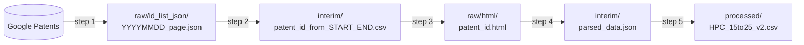

# Google Patents HPC 資料集流程

用 Python 腳本分五個步驟，從 [Google Patents](https://patents.google.com/) 建立專利資料集：
逐日查詢 Google Patents、整理專利號清單、下載每篇專利頁面、解析頁面，最後攤平成一個 CSV 檔。第六步是 `colab/` 裡的 Colab notebook，把這個 CSV 檔轉成釋出資料集（見 [Step 6](#step-6在-colab-產生釋出資料集colab-裡的-notebook)）。

預設設定會重現 **HPC 資料集**：符合查詢式 `(HPC)`、美國、已獲證、英文，且**申請日（filing date）**介於 2015-01-01 到 2025-12-31 的專利。所有設定都可以用命令列參數修改。

English version: [README.md](README.md)

## 快速使用

```bash
git clone https://github.com/Taco-Yun/hpc-patent-dataset.git
cd hpc-patent-dataset
uv sync                                         # 安裝相依套件（只需一次）
bash scripts/run_sample.sh 20150118 20150119    # sample：申請日 2015-01-18 到 2015-01-19 -> data/sample/
bash scripts/run_full.sh                        # 完整執行：2015-01-01 到 2025-12-31 -> data/
```

`bash scripts/run_sample.sh 20150118 20150119` 會依序執行這五個指令：

```bash
uv run python src/step1_fetch_search_results.py  --data-dir data/sample --start 20150118 --end 20150119  # 查詢 -> raw/id_list_json/
uv run python src/step2_extract_patent_ids.py    --data-dir data/sample --start 20150118 --end 20150119  # -> interim/patent_id_from_20150118_20150119.csv
uv run python src/step3_download_patent_pages.py --data-dir data/sample --start 20150118 --end 20150119  # -> raw/html/
uv run python src/step4_parse_patent_pages.py    --data-dir data/sample                                  # -> interim/parsed_data.json
uv run python src/step5_build_hpc_dataset.py     --data-dir data/sample                                  # -> processed/HPC_15to25_v2.csv
```

`bash scripts/run_full.sh` 執行的是同樣五個指令，參數換成 `--data-dir data --start 20150101 --end 20251231`；
這也正是預設值，所以五個指令都不帶參數，就等於完整執行。
其他日期區間或資料夾，把五個指令的 `--data-dir`、`--start`、`--end` 換成自己的值即可。

只想看會執行哪些指令、不實際執行：`PYTHON="echo uv run python" bash scripts/run_sample.sh 20150118 20150119`。

## 目錄

- [快速使用](#快速使用)
- [流程總覽](#流程總覽)
- [目錄結構](#目錄結構)
- [系統需求](#系統需求)
- [安裝](#安裝)
- [快速開始：sample 試跑](#快速開始sample-試跑)
- [完整執行](#完整執行)
- [各步驟說明](#各步驟說明)
- [輸出欄位](#輸出欄位hpc_15to25_v2csv)
- [瀏覽器自動化注意事項（版本相容）](#瀏覽器自動化注意事項版本相容)
- [執行時間與磁碟空間](#執行時間與磁碟空間)
- [已知限制](#已知限制)
- [使用規範](#使用規範)
- [授權](#授權)

## 流程總覽



| 步驟 | 腳本 | 讀取 | 輸出 | 需要網路 |
|---|---|---|---|---|
| 1 | `src/step1_fetch_search_results.py` | 查詢設定 | `raw/id_list_json/{YYYYMMDD}_{page}.json` | 是（Chrome） |
| 2 | `src/step2_extract_patent_ids.py` | `raw/id_list_json/*.json` | `interim/patent_id_from_{start}_{end}.csv` | 否 |
| 3 | `src/step3_download_patent_pages.py` | `interim/patent_id_from_{start}_{end}.csv` | `raw/html/{patent_id}.html` | 是（HTTP） |
| 4 | `src/step4_parse_patent_pages.py` | `raw/html/*.html` | `interim/parsed_data.json` | 否（加 `--download-pdf` 時才需要） |
| 5 | `src/step5_build_hpc_dataset.py` | `interim/parsed_data.json` | `processed/HPC_15to25_v2.csv` | 否 |
| 6 | `colab/step6_patentsum_pipeline.ipynb`（Colab notebook，需 GPU） | `processed/HPC_15to25_v2.csv`、USPTO `patents.dta` | `SAVE_DIR/release/`（在 notebook 裡設定） | 是（下載模型） |

表中路徑都相對於**資料目錄**，用 `--data-dir` 指定（預設 `data/`）。

## 目錄結構

```
.
├── src/                         step 1-5 各一支 Python 腳本，加上 utils.py
├── colab/                       step 6 的 notebook，在 Google Colab（GPU）上執行
├── scripts/
│   ├── run_sample.sh            小時間區間跑 step 1-5   -> data/sample/
│   ├── run_full.sh              2015-01-01..2025-12-31 跑 step 1-5 -> data/
│   └── run_pipeline.sh          上面兩支共用的執行腳本
├── data/                        完整執行的資料目錄（附少量範例檔）
│   ├── raw/id_list_json/        step 1 輸出
│   ├── raw/html/                step 3 輸出
│   ├── raw/pdf/                 step 4 加 --download-pdf 時的輸出（不上傳）
│   ├── interim/                 step 2、step 4 輸出
│   ├── processed/               step 5 輸出
│   └── sample/                  run_sample.sh 的完整輸出（子目錄相同）
├── pyproject.toml               相依套件（uv）
├── uv.lock                      鎖定的確切版本（uv）
├── .python-version              uv 使用的 Python 版本（3.10）
├── requirements.txt             同樣的確切版本，給 pip 用
└── LICENSE
```

### `data/` 裡附了哪些檔案

| 路徑 | 內容 |
|---|---|
| `data/sample/` | `scripts/run_sample.sh` 在申請日 2015-01-09 的完整輸出，前後一致：1 頁查詢結果 → 5 個專利號 → 5 個專利頁面 → 5 筆解析結果 → 5 列 CSV。 |
| `data/interim/patent_id_from_20150101_20251231.csv` | 我們完整跑 step 1-2 得到的專利號清單，共 21,947 個美國專利號。 |
| `data/raw/id_list_json/` | 5 個查詢結果頁範例（申請日 2015-01-02、2015-01-05、2015-01-06，以及 2015-01-21 的兩頁）。 |
| `data/raw/html/` | 10 個專利頁面範例。 |
| `data/interim/parsed_data.json`、`data/processed/HPC_15to25_v2.csv` | 用這 10 個頁面跑 step 4-5 的結果（10 筆、10 列）。 |

完整執行的輸出（光 HTML 就約 16 GB，見[執行時間與磁碟空間](#執行時間與磁碟空間)）不放在這個 repo。

## 系統需求

| | |
|---|---|
| **作業系統** | 爬取**建議用 Linux**，長時間在伺服器上跑尤其如此。**macOS 可用。** **Windows 沒有測試過**；shell 腳本需要 bash。 |
| **Python** | 3.10（寫在 `.python-version`；沒有的話 uv 會自動下載）。3.12 的狀況見[這裡](#瀏覽器自動化注意事項版本相容)。 |
| **uv** | 套件與虛擬環境管理工具，安裝方式見下方。 |
| **Google Chrome** | 只有 step 1 需要。 |
| **磁碟空間** | sample 試跑只要幾 MB；完整執行需要數十 GB。 |

## 安裝

### 1. 安裝 uv

```bash
curl -LsSf https://astral.sh/uv/install.sh | sh
```

macOS 也可以用 Homebrew：`brew install uv`。用 `uv --version` 確認安裝成功。

### 2. 安裝相依套件

在 repo 根目錄執行：

```bash
uv sync
```

這會建立 `.venv/`，並安裝 `uv.lock` 裡鎖定的確切版本（需要時也會安裝 Python 3.10）。
執行腳本時用 `uv run python ...`，不必先啟用虛擬環境。
想啟用的話：`source .venv/bin/activate`，之後直接用 `python ...`。

**另一種方式：不用 `uv sync`，改用 `uv pip`。** 適合想自己管理虛擬環境的人：

```bash
uv venv --python 3.10
uv pip install -r requirements.txt
source .venv/bin/activate
```

也可以用 `uv pip install -r pyproject.toml`（只裝到最低版本要求，不是鎖定版本）。
用一般 pip 的話，在 Python 3.10 的虛擬環境裡執行 `pip install -r requirements.txt`。
不用 `uv run` 時，要告訴 shell 腳本改用哪個 Python：`PYTHON=python bash scripts/run_sample.sh`。

### 3. 安裝 Google Chrome（只有 step 1 需要）

- **macOS**：從 <https://www.google.com/chrome/> 安裝。
- **Ubuntu / Debian**：

  ```bash
  wget https://dl.google.com/linux/direct/google-chrome-stable_current_amd64.deb
  sudo apt install ./google-chrome-stable_current_amd64.deb
  ```

## 快速開始：sample 試跑

**離線檢查（幾秒鐘，不連網、不需要 Chrome）：**

```bash
bash scripts/run_sample.sh --offline
```

這會用 `data/sample/` 裡現有的檔案跑 step 2、4、5，確認安裝沒問題。
最後一行應該是 `Done. Final dataset: data/sample/processed/HPC_15to25_v2.csv`（5 列）。

**實際試跑（五個步驟全跑）：**

```bash
bash scripts/run_sample.sh                      # 申請日 2015-01-09
bash scripts/run_sample.sh 20150118 20150119    # 其他區間：START END（YYYYMMDD）
```

step 1 會開一個 Chrome 視窗，等 20 秒，再對區間內每一天查詢 Google Patents。
已經存在的檔案會跳過，所以預設日期大部分工作都已經做完；想測一次全新的爬取，請換一個區間。
建議在完整執行前先跑 sample，確認 Chrome、driver 和網路都正常。

注意：step 4、5 永遠會處理 `<data-dir>/raw/html/` 裡的**所有**頁面，所以之前 sample 區間下載的頁面也會留在 sample 的輸出裡。

## 完整執行

```bash
bash scripts/run_full.sh        # 會先詢問確認
bash scripts/run_full.sh -y     # 不詢問
```

這會對申請日 2015-01-01 到 2025-12-31 跑 step 1-5，輸出到 `data/`。
過程會發出數萬次請求、花上好幾個小時（[估計](#執行時間與磁碟空間)）。
兩個爬取步驟都會跳過已存在的檔案，所以中途停掉（網路錯誤、被封鎖、筆電闔上）時，**再執行同一個指令就會接續**。

shell 腳本的選項用環境變數傳入：

| 變數 | 效果 |
|---|---|
| `PROXY=http://<ip>:<port>` | step 1、3 走 proxy（建議使用，避免 IP 被封鎖）。 |
| `HEADLESS=1` | step 1 的 Chrome 不開視窗。 |
| `CHROME_VERSION=<主版本>` | step 1 使用的 Chrome 主版本號（預設自動偵測）。 |
| `DOWNLOAD_PDF=1` | step 4 一併下載專利 PDF。 |
| `OFFLINE=1` | 跳過 step 1、3（兩個爬取步驟）。 |
| `PYTHON="python"` | 執行 Python 的指令（預設 `uv run python`）。 |

範例：`PROXY=http://127.0.0.1:8080 HEADLESS=1 bash scripts/run_full.sh -y`

> **注意：** step 2 會依照 `data/raw/id_list_json/` 當下的內容重建 `data/interim/patent_id_from_20150101_20251231.csv`。
> 如果 step 1 還沒跑完就執行 step 2，repo 附的完整清單會被不完整的清單取代
> （可用 `git checkout data/interim/patent_id_from_20150101_20251231.csv` 還原）。

### 逐步執行

不帶參數時，每支腳本都使用 HPC 資料集的設定和 `data/` 目錄：

```bash
uv run python src/step1_fetch_search_results.py
uv run python src/step2_extract_patent_ids.py
uv run python src/step3_download_patent_pages.py
uv run python src/step4_parse_patent_pages.py
uv run python src/step5_build_hpc_dataset.py
```

每支腳本都可以用 `--help` 查看選項。想跳過 step 1、直接下載 repo 附的 21,947 筆清單，從 step 3 開始即可。

## 各步驟說明

### Step 1：抓查詢結果（`step1_fetch_search_results.py`）

- 透過 undetected-chromedriver 開啟 Chrome，等待 20 秒。
- 對 `[--start, --end]` 區間內的每一天，以 `after=filing:<日期>`、`before=filing:<日期>` 請求
  `https://patents.google.com/xhr/query`，也就是**一次查一個申請日**；逐頁往下抓，直到某頁沒有結果，或已存下 Google Patents 回報的最後一頁。
- 每個有結果的頁面存成 `{YYYYMMDD}_{page:03d}.json`，第一頁是 `000`。沒有結果的日期不會產生檔案。
- 每次請求後等 1 秒，每存一頁再等 1 秒。某一天出錯時最多重試 3 次，每次間隔 5 秒。

| 選項 | 預設 | 說明 |
|---|---|---|
| `--data-dir` | `data` | 資料目錄 |
| `--start`、`--end` | `20150101`、`20251231` | 申請日區間，`YYYYMMDD`，頭尾都包含 |
| `--query` | `(HPC)` | 查詢式 |
| `--country` | `US` | 國家 |
| `--status` | `GRANT` | 狀態 |
| `--language` | `ENGLISH` | 語言 |
| `--type` | `PATENT` | 文件類型 |
| `--proxy` | 無 | proxy 伺服器，`http://<ip>:<port>` |
| `--headless` | 關閉 | Chrome 不開視窗 |
| `--chrome-version` | 自動 | Chrome 主版本號 |

### Step 2：整理專利號（`step2_extract_patent_ids.py`）

- 讀取檔名日期落在 `[--start, --end]` 內的 JSON 檔。
- 保留含有 `/US` 的結果 `id`，取出其中的專利號（`patent/US9483319B2/en` → `US9483319B2`）。
- 去除重複，依文字排序。
- 寫出 `interim/patent_id_from_{start}_{end}.csv`，兩欄：`number`（1、2、3……）與 `patent_number`。

選項：`--data-dir`、`--start`、`--end`（預設同 step 1）。

### Step 3：下載專利頁面（`step3_download_patent_pages.py`）

- 從清單第二欄讀取專利號（跳過標題列）。
- 用一般 HTTP 請求（不開瀏覽器，逾時 5 秒）抓 `https://patents.google.com/patent/{patent_id}`。
- 頁面存成 `raw/html/{patent_id}.html`，例如 `raw/html/US9483319B2.html`。
  Google Patents 回 **404** 時，把回應存成 `raw/html/{patent_id}_404.html`，之後就不會再請求這個專利號。
- 已經有上述任一檔案的專利號會跳過。
- 每下載一頁等 1 秒；清單中每第 30 個專利號（有實際下載時）再額外等 30 秒。
- 網路錯誤和其他 HTTP 錯誤（例如 403、429、500）最多重試 3 次，每次間隔 5 秒。
  仍然失敗的專利號不會留下檔案，再跑一次 step 3 就會重試。

| 選項 | 預設 | 說明 |
|---|---|---|
| `--data-dir` | `data` | 資料目錄 |
| `--start`、`--end` | `20150101`、`20251231` | 選擇清單 `interim/patent_id_from_{start}_{end}.csv` |
| `--id-list` | 由上兩項推得 | 直接指定任一清單 CSV 的路徑（優先於 `--start`/`--end`） |
| `--proxy` | 無 | proxy 伺服器，`http://<ip>:<port>` |

### Step 4：解析專利頁面（`step4_parse_patent_pages.py`）

- 依檔名順序解析每個 `raw/html/*.html`，跳過 `*_404.html` 標記檔。
- 寫出 `interim/parsed_data.json`，格式是 **JSON Lines**：每行一個 JSON 物件、一行一篇專利
  （可用 `pandas.read_json(path, lines=True)` 讀取）。欄位：`title`、`abstract`、`patent_id`、`image_urls`、
  `classifications`、`pdf_info`、`inventors`、`current_assignee`、`events`、`description`、`claims`、
  `patent_citations`、`non_patent_citations`、`cited_by`、`similar_documents`、`parent_applications`、
  `applications_claiming_priority`、`legal_events`。
- 某個頁面解析失敗時，會印出錯誤、**只略過那一頁**，其餘照常處理；結束時會列出被略過的頁面。
- `--download-pdf`（預設關閉）會一併把專利 PDF 下載到 `raw/pdf/`（每份約 3 MB）。
  `pdf_info.path` 一律記錄 PDF 存放（或應存放）的位置；只有加了 `--download-pdf` 時檔案才會真的存在。

選項：`--data-dir`、`--download-pdf`。

像 `Not found: ...` 或 `Parsing error: <h2> heading containing '...' not found` 這類訊息，
代表該頁面沒有某個非必要的區塊，屬於正常現象。只有 `⛔ Failed to parse, skipped: ...` 代表有頁面被略過。

### Step 5：產生 CSV 資料集（`step5_build_hpc_dataset.py`）

- 讀取 `interim/parsed_data.json`，寫出 `processed/HPC_15to25_v2.csv`，一列一篇專利，共 33 欄（見下表）。
- 攤平時出錯的紀錄會印出 `Error, record skipped: ...` 並排除，例如完全沒有分類的專利。
- 輸出檔名固定，sample 試跑也一樣。

選項：`--data-dir`。

### Step 6：在 Colab 產生釋出資料集（`colab/` 裡的 notebook）

Step 6 把 `processed/HPC_15to25_v2.csv` 轉成釋出資料集：移除 HPC 指其他意思的紀錄、套用語料規則、由語言模型寫出
三個摘要層、SPECTER2 向量、分群與主題、權屬證據、技術驗證，最後寫出釋出檔。這一步需要 GPU，寫成 Colab notebook，
共三個版本，程式碼只差在抽樣版的 `PROFILE` 設定：

| Notebook | 用途 | 開啟 |
|---|---|---|
| `colab/step6_patentsum_pipeline.ipynb` | 完整執行（英文） | [Colab](https://colab.research.google.com/github/Taco-Yun/hpc-patent-dataset/blob/main/colab/step6_patentsum_pipeline.ipynb) |
| `colab/step6_patentsum_pipeline_tw.ipynb` | 同一份 notebook，說明文字為繁體中文 | [Colab](https://colab.research.google.com/github/Taco-Yun/hpc-patent-dataset/blob/main/colab/step6_patentsum_pipeline_tw.ipynb) |
| `colab/step6_patentsum_pipeline_sample.ipynb` | 隨機抽 400 筆，把每一格都跑一遍的測試版 | [Colab](https://colab.research.google.com/github/Taco-Yun/hpc-patent-dataset/blob/main/colab/step6_patentsum_pipeline_sample.ipynb) |

GitHub 只會顯示 notebook，不會執行；點 Colab 連結會直接從這個 repository 在 Google Colab 開啟，在那裡執行。
notebook 的輸入檔從 Google Drive 讀取（`MyDrive/patent_HPC/`，在 1.3 設定）。

除了 `HPC_15to25_v2.csv`，step 6 還要讀 USPTO Patent Litigation Docket Reports 的 `patents.dta`（地方法院案件，
用於訴訟標註）。所有設定都在 notebook 的 1.3 這一格。facet 與三個摘要層的生成在釋出版本中用一張 A100 80 GB 約花 20 小時；
也可以沿用先前某次執行的生成結果（`REUSE_DIR`），此時估計約需 1 到 1.5 小時。輸出寫到 `SAVE_DIR`
（本機為 `data/step6/<profile>/`，不會被 commit）。

## 輸出欄位（`HPC_15to25_v2.csv`）

| 欄位 | 內容 |
|---|---|
| `patent_id` | 公告號，例如 `US9483319B2`（即 HTML 檔名） |
| `title` | 標題（`DC.title` meta 標籤） |
| `abstract` | 摘要 |
| `main_ipc` | 第一個分類群組最後一筆的代碼，截到 `/` 之前（例如 `A61K47`） |
| `main_ipc_description` | 該筆的說明 |
| `main_ipc_4` | 第一個分類群組中，第一個含兩個以上英文字母、且以字母結尾的代碼；實際上就是 4 碼的次類（例如 `A61K`） |
| `main_ipc_description_4` | 該筆的說明 |
| `ipc_description` | 每個分類群組的最後一筆，格式為 `{'ipc': 截到 '/' 的代碼, 'ipc_description': ...}` |
| `current_assignee` | 第一個現任受讓人 |
| `assignee`、`application_date`、`application_year` | 取自第一個類型為 `filed`、且標題含 "application" 的事件 |
| `priority_date`、`priority_title` | 取自第一個類型為 `priority` 的事件 |
| `reassignment_assignee`、`reassignment_date` | 取自第一個類型為 `reassignment` 的事件 |
| `expiration_date`、`expiration_title` | 取自第一個標題為 "Anticipated expiration" 或 "Adjusted expiration" 的 `legal-status` 事件 |
| `granted_date`、`granted_title` | 取自第一個類型為 `granted` 的事件 |
| `CROSS-REFERENCE TO RELATED APPLICATION`、`BACKGROUND`、`SUMMARY`、`DETAILED DESCRIPTION`、`BRIEF DESCRIPTION OF THE DRAWINGS` | 說明書中標題完全相同的段落內容；其他標題下的文字會併入前一個能辨識的段落；沒有該標題時為 `N/A` |
| `claim_count` | 解析出的請求項數量 |
| `claims_text` | 全部請求項，換行改成空白，以 `；`（全形分號，U+FF1B）串接 |
| `citation_count` | 專利引用數 |
| `citations` | 專利引用清單，每筆為 `{publication_number, publication_date, assignee, title}` |
| `non_patent_citation` | 非專利引用數 |
| `applications_claiming_priority` | 「Applications Claiming Priority」表格的各列 |
| `legal_events` | 「Legal Events」表格的各列 |
| `patent_url` | `https://patents.google.com/patent/{patent_id}` |

**讀取時要注意：**

- 缺值依欄位不同，會寫成 `NA`、`N/A` 或空白。
  pandas 預設會把 `NA`、`N/A` 讀成缺值；想看到原始值請加 `keep_default_na=False`。
- 清單類欄位（`ipc_description`、`citations`、`applications_claiming_priority`、`legal_events`）存的是
  **Python literal**（單引號），不是 JSON，要用 `ast.literal_eval` 解析：

```python
import ast
import pandas as pd

df = pd.read_csv("data/processed/HPC_15to25_v2.csv", keep_default_na=False)
df["citations"] = df["citations"].apply(ast.literal_eval)
```

**關於欄位名稱裡的 `ipc`：** 這些代碼取自 Google Patents 頁面的 *Classifications* 區塊。
我們檢查過的所有頁面（77 頁、6,215 筆分類）每一筆都標記為 `IsCPC="true"`，
所以實際上是 **CPC** 代碼；欄位名稱保留 `ipc` 是為了相容。

## 瀏覽器自動化注意事項（版本相容）

step 1 用 **undetected-chromedriver 3.5.5**（底層是 selenium）操作真的 Chrome 瀏覽器。
這是整個流程最容易出問題的地方；step 1 失敗時請先檢查以下幾點。

1. **Chrome 與 driver 版本必須對上。** undetected-chromedriver 會偵測已安裝的 Chrome 版本，
   並下載對應的 chromedriver。偵測失敗，或 Chrome 在兩次執行之間自動更新時，瀏覽器會啟動失敗，
   錯誤訊息會提到 Chrome / ChromeDriver 的版本。這時請明確指定主版本號：
   `--chrome-version <主版本>`（shell 腳本用 `CHROME_VERSION=<主版本>`），主版本號就是
   `chrome://version` 裡第一個點之前的數字。在伺服器上長時間執行時，避免 Chrome 在途中更新。
2. **Python 3.12 以上。** undetected-chromedriver 3.5.5 會 import `distutils`，而 Python 3.12 已經移除它。
   相依套件裡的 `setuptools` 會補上。我們確認過在 Python 3.12.12 上可以正常 import，且 step 2-5 的輸出完全相同；
   step 1 本身只在 Python 3.10 上跑過。
   Python 3.10 在 2026 年 10 月停止支援；要切換的話，把 `.python-version` 改成 `3.12` 再執行 `uv sync`。
3. **預設需要螢幕。** Chrome 會開一個看得到的視窗。在沒有桌面環境的 Linux 伺服器上，
   可以用虛擬螢幕（`sudo apt install xvfb`，再執行 `xvfb-run -a bash scripts/run_full.sh`），
   或改用 `HEADLESS=1` / `--headless`。
4. **固定的啟動等待。** step 1 在 Chrome 啟動後會先等 20 秒才開始查詢。
5. **封鎖。** 同一個 IP 發出大量請求可能被限速或封鎖。請使用 proxy（`PROXY=...`）；
   再執行同一個指令就會從中斷處接續。
6. **作業系統。** 建議 Linux，macOS 可用；Windows 沒有測試過。

## 執行時間與磁碟空間

以下是完整預設執行的估計值。等待時間來自腳本內建的延遲（另外還要加上網路傳輸時間）；
檔案大小是用 77 篇已下載專利的平均值乘上 21,947 篇。

| 項目 | 估計 |
|---|---|
| Step 1 | 4,018 個申請日。每天約有（2 × 結果頁數 + 1）秒的內建等待，另加頁面載入時間。若每天都只有一頁結果，至少 3.3 小時。 |
| Step 3 | 21,947 頁 × 1 秒 + 731 次 × 30 秒暫停 = 約 12.2 小時的內建等待。 |
| HTML 頁面 | 每頁約 0.75 MB → 約 16 GB |
| PDF（選用） | 每份約 3.2 MB → 約 69 GB |
| `parsed_data.json` | 每篇約 109 KB → 約 2.3 GB |
| `HPC_15to25_v2.csv` | 每列約 87 KB → 約 1.8 GB |

step 2、4、5 都是離線執行。

## 已知限制

- **Google Patents 會變動。** 查詢結果會隨時間改變，之後重跑 step 1 可能得到不同的專利號清單。
  解析程式依賴頁面的 HTML 結構（`itemprop` 屬性、區塊標題），頁面改版時可能需要更新。
- **日期是申請日**，不是獲證日或公告日。
- **請求項。** 解析出的請求項數量和頁面顯示的數量不一致時，請求項會留空
  （`claim_count` 為 0、`claims_text` 為空白）。在我們的樣本中，77 頁有 2 頁發生這種情況。
- **引用區塊是用標題文字找的。** 專利引用會取第一個含有 "Patent Citations" 的標題。
  如果某頁有 *Non-Patent Citations* 卻沒有 *Patent Citations*，非專利引用的表格會被當成專利引用讀進來。
  我們檢查過的 77 頁都沒有發生。
- **step 5 會排除的紀錄。** 完全沒有分類的專利不會出現在 CSV 裡。
- **說明書段落**只解析專利號含 `US`（五個段落）或 `EP`（全部文字放在 `CROSS-REFERENCE TO RELATED APPLICATION` 欄）的專利。
  step 2 只保留美國專利，所以預設執行不受影響。

## 使用規範

腳本在請求之間都有等待，以降低對 Google Patents 的負擔，請不要移除這些延遲。
爬取前請先確認 Google Patents 的服務條款，並將資料用於研究用途。

## 授權

[MIT](LICENSE)
